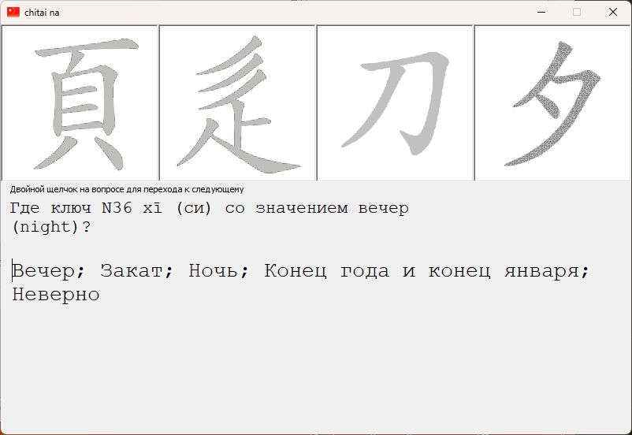

# chitai na

Тренажёр для запоминания 214 иероглифических ключей (ключей Канси).



## Как работает

Программа показывает четыре случайных ключа и вопрос вида «Где ключ N75 mù (му) со значением дерево (tree)?», ниже — описание ключа.

- щелчок по верной картинке — проигрывается видео по этому ключу;
- щелчок по неверной — звуковой сигнал и подсказка, какой ключ выбран;
- двойной щелчок по вопросу — следующий вопрос (после верного ответа).

## Требования

- включённый компонент «Windows Media Player»: «Программы и компоненты» → «Включение или отключение компонентов Windows» → «Компоненты для работы с мультимедиа». Без него видеоплееры в окне не создаются.

Видео (`mp4\`) должны лежать рядом с `chitai_na.exe`; логи пишутся в `logs\` там же.

## CI и релизы

GitHub Actions (`.github/workflows/ci.yml`) при каждом push в `trunk` и в pull request собирает Release x64, запускает тесты и сохраняет cab-пакет (exe, `mp4\`, LICENSE, README) в артефактах сборки.

Для выпуска релиза необходимо поднять версию в version.h, влить изменения в trunk и отправить тег вида v2.1:

```
git tag v2.1
git push origin v2.1
```

CI проверит, что тег совпадает с версией в `src/version.h`, и опубликует релиз с cab-пакетом на странице Releases.
